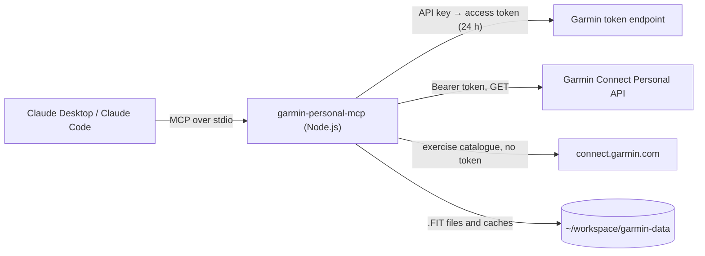

# garmin-personal-mcp

[](LICENSE)
[](https://nodejs.org)
[](tsconfig.json)
[](https://modelcontextprotocol.io)
[](https://developer.garmin.com/gc-developer-program/personal/)

<p align="center">
  <b><a href="#quick-start">Quick start</a></b> &middot;
  <b><a href="#prompts">Prompts</a></b> &middot;
  <b><a href="#tools">Tools</a></b> &middot;
  <b><a href="#configuration">Configuration</a></b> &middot;
  <b><a href="#presets-or-freeform">Presets or freeform</a></b> &middot;
  <b><a href="#security">Security</a></b> &middot;
  <b><a href="guide/dashboard.md">Dashboard guide</a></b>
</p>

**Your Garmin training in Claude, through the official Personal API. Read-only, nothing to
install.**

MCP server for the official Garmin Connect Personal API. Read-only access to activities, laps and
strength sets from .FIT files, HRV, sleep and heart rate. Includes a training and recovery
dashboard with widgets that you can arrange. Runs with npx, with nothing to install.

With this server, you can ask Claude:

- "List my last 5 activities, with pace and heart rate."
- "Show the laps of my last run."
- "Compare my sets of this week with the week before."
- "How did I sleep this week, and how was my HRV?"

Ready-made prompts do more:

- **training-dashboard** writes a dashboard page in less than a minute. It shows your training
  load next to HRV, sleep and resting heart rate, in widgets that you can move, resize, hide and
  add. You can also let Claude design the whole page.
- **training-dashboard-update** adds the new data to the dashboard. Your layout stays.
- **dashboard-widget** makes a new widget from your idea.
- **dashboard-language** adds a language to the dashboard.


_The training dashboard with demo data._

The server works with Claude Desktop, Claude Code and all other MCP clients that use stdio.

## Quick start

You need Node.js 22 or later (`node --version` shows the version) and a Garmin Connect account
with access to the [Personal API](https://developer.garmin.com/gc-developer-program/personal/).

### 1. Create a personal API key

1. Open Garmin Connect web at <https://connect.garmin.com/app/settings/personalApiToken>.
2. Select _Create Key_, accept the terms, select the expiry (1 year at most) and select _Create_.
3. Garmin shows the key **only one time**. Save it in a file that only you can read:

```bash
mkdir -p ~/.config/garmin-mcp
nano ~/.config/garmin-mcp/api-key      # paste the key and save
chmod 600 ~/.config/garmin-mcp/api-key
```

You can also give the key in the environment variable `GARMIN_PERSONAL_API_KEY`.

### 2. Connect your client

**Claude Desktop**: select Settings → Developer → _Edit Config_. Add a top-level `mcpServers` key
next to the keys that the file has, not in `preferences`:

```json
{
  "mcpServers": {
    "garmin-personal": {
      "command": "npx",
      "args": ["-y", "@indaco/garmin-personal-mcp"]
    }
  }
}
```

Then quit Claude Desktop **fully**, including the tray icon, and start it again.

**Claude Code**: this command adds the server to all your projects:

```bash
claude mcp add garmin-personal --scope user -- npx -y @indaco/garmin-personal-mcp
claude mcp list          # garmin-personal: ... ✔ Connected
```

Use `--scope project` to write a `.mcp.json` file that you can share in the current repository.

Before the first npm release, use the server from source. [Development](#development) gives the
procedure.

### 3. Ask Claude

Ask "list my last 5 activities". The first time that a garmin-personal tool asks for permission, answer
**Allow always** in Claude Desktop. In Claude Code, use `/permissions` and add `mcp__garmin-personal`.

## Prompts

In Claude Desktop, the prompts are in the **+** menu of the message box, under _garmin-personal_. In
Claude Code, they are slash commands such as `/mcp__garmin-personal__training-dashboard`.

The prompts remove all spaces around an argument, also the no-break space from a phone keyboard.

After an update of the server, the prompts and tools change only in a new Claude Code session. In
Claude Desktop, they change after a full restart.

### training-dashboard

The server writes the dashboard page from its template, and Claude writes the coach notes. The page
is one HTML file, `garmin-dashboard.html` in the data folder. It works offline.

| Argument | Values                            | Default  |
| -------- | --------------------------------- | -------- |
| `weeks`  | 1 to 52 (a larger value gives 52) | 12       |
| `layout` | `preset`, `blank` or `freeform`   | `preset` |

- `preset` gives the built-in widgets on each board.
- `blank` gives empty boards: you add the widgets that you want.
- `freeform` lets Claude design the whole page. This takes much longer, and each page looks
  different.

| Client         | How to run it                                                               |
| -------------- | --------------------------------------------------------------------------- |
| Claude Desktop | **+** → _garmin-personal_ → `training-dashboard` → set the arguments → send |
| Claude Code    | `/mcp__garmin-personal__training-dashboard 8`                               |

In Claude Code, the arguments are in order and separated by spaces: first `weeks`, then `layout`.
To give `layout`, also give `weeks`: `/mcp__garmin-personal__training-dashboard 12 freeform`.

Claude gives you the path of the page and the command to open it. The page has:

- the All and Recovery boards, and a board for each sport: Run, Strength, Walk, Bike and Racket
  sports. Hike, Swim, Other and each other sport have a board when you have them;
- on the All board: an overview, readiness for today next to a consistency calendar, a period
  comparison, records, weekly volume, intensity minutes, load safety, load against recovery and the
  coach notes;
- on the Recovery board: readiness, fitness age, load against recovery and the 14-day recovery
  widgets (HRV, resting HR, sleep, sleep need, bedtime and Body Battery);
- on each type board: a summary, the weekly chart, the time in HR zones and the widgets of that
  sport, for example best efforts and a race predictor for Run, and each exercise with its trend
  for Strength;
- a week window, 11 themes, and English and Italian texts.

The dashboard uses the training load, HR zones and training effect from Garmin. It labels each
value that it calculates as an estimate. It does not invent missing values: a missing value shows
as "n/a".

[Presets or freeform](#presets-or-freeform) compares the two methods, with measurements. [The dashboard guide](guide/dashboard.md) tells how to change the layout, and
[the widget catalogue](guide/widgets.md) lists every widget.

### training-dashboard-update

This prompt replaces the data and the coach notes of the page. Your layout, your custom widgets and
your languages stay. Leave `weeks` empty to keep the weeks of the page. Reload the page to see the
new data.

| Client         | How to run it                                                  |
| -------------- | -------------------------------------------------------------- |
| Claude Desktop | **+** → _garmin-personal_ → `training-dashboard-update` → send |
| Claude Code    | `/mcp__garmin-personal__training-dashboard-update`             |

The first call sends approximately 35 requests to Garmin. Later calls use the local cache and send
approximately 8.

### dashboard-widget

This prompt makes a new widget from your idea, for example "my longest ride of each month". Claude
writes a small widget, and `editDashboard` stores it in the page. The widget stays after each
update. The argument `idea` is required. Reload the page to see the widget.
[Custom widgets](guide/custom-widgets.md) tells more.

### dashboard-language

This prompt adds a language to the dashboard. Claude translates the texts of the page, and
`editDashboard` stores them in the page. The argument `language` is optional: the default is the
language of the conversation. A text without a translation shows in English.
[Languages](guide/languages.md) tells more.

## Tools

| Tool                  | Endpoint                                             | What it gives                                                                                                                                                                                                                                                                                                                                               |
| --------------------- | ---------------------------------------------------- | ----------------------------------------------------------------------------------------------------------------------------------------------------------------------------------------------------------------------------------------------------------------------------------------------------------------------------------------------------------- |
| `listActivities`      | `/activitylist-service/activities/search/activities` | a compact summary of each activity: the Garmin type key and the FIT SDK sport name, km, moving and elapsed time, pace, HR, cadence, ascent, HR-zone seconds, Garmin training load and training effect, intensity minutes, race flag, best efforts, power, running form, run/walk segments, swim SWOLF, lengths and strokes. `raw=true` gives the full JSON. |
| `getActivity`         | `/activity-service/activity/{id}`                    | summary, metadata and segments by type                                                                                                                                                                                                                                                                                                                      |
| `getActivityLaps`     | `/download-service/files/activity/{id}`              | laps from the .FIT file: km, time, pace or speed, HR, cadence, ascent, power and intensity                                                                                                                                                                                                                                                                  |
| `getActivitySets`     | `/download-service/files/activity/{id}`              | strength sets from the .FIT file: exercise, movement category, primary and secondary muscles, reps, weight (kg), set time and the rest after the set. The empty set that the watch adds at the end of a workout is not shown                                                                                                                                |
| `downloadActivityFit` | `/download-service/files/activity/{id}`              | saves `{id}.fit` in the `fit` folder of the data folder. The server downloads each file one time only.                                                                                                                                                                                                                                                      |
| `getHrvRange`         | `/hrv-service/hrv/daily/{from}/{to}`                 | HRV during the night                                                                                                                                                                                                                                                                                                                                        |
| `getDailyHeartRate`   | `/wellness-service/wellness/dailyHeartRate`          | the heart rate of a day, with the resting HR                                                                                                                                                                                                                                                                                                                |
| `getSleep`            | `/sleep-service/sleep/dailySleep`                    | the sleep of a night. The date is the morning after the night.                                                                                                                                                                                                                                                                                              |
| `getHeartRateZones`   | `/biometric-service/heartRateZones/v2`               | the HR zones in Garmin Connect                                                                                                                                                                                                                                                                                                                              |
| `getFitnessAge`       | `/fitnessage-service/fitnessage/v2/{date}`           | fitness age against actual age, and its components                                                                                                                                                                                                                                                                                                          |
| `getDailySummary`     | `/usersummary-service/usersummary/daily`             | steps, stress and body battery                                                                                                                                                                                                                                                                                                                              |
| `getDashboardData`    | the endpoints above                                  | all the data of the dashboard in one call. It keeps a local cache and asks Garmin only for new days.                                                                                                                                                                                                                                                        |
| `writeDashboard`      | the endpoints above                                  | writes the dashboard page (default `garmin-dashboard.html` in the data folder) and gives a short digest of the data for the coach notes. An update changes only the data of the page. A replaced page is kept as `.bak`.                                                                                                                                    |
| `editDashboard`       | none                                                 | changes the layout of the dashboard page, adds or removes custom widgets, and adds languages. Without arguments, it gives the layout, the widget catalogue and the guide for a custom widget.                                                                                                                                                               |
| `garminGet`           | all other GET endpoints                              | a relative path and a query string                                                                                                                                                                                                                                                                                                                          |

Dates use the format `yyyy-MM-dd`. The API reference does not always give the names of the query
parameters. If an endpoint answers 400, Claude can use `garminGet` to try a different name.
`listActivities` with `activityType` sometimes answers 400. `garminGet` decodes the query string
before it sends it, so an encoded value such as `calendarDate=2026%2D10%2D24` also works.
API reference: <https://developer.garmin.com/gc-developer-program/personal/swagger-docs/>

The Personal API does not have these Garmin Connect data, and their endpoints answer 404:

- VO2 max, training status and readiness, race predictions and personal records;
- weight, gear and activity weather;
- endurance and hill score, lactate threshold and exercise sets.

When the dashboard needs one of these values, it calculates an estimate and labels it.

## Configuration

All the settings are environment variables, and all of them are optional.

| Variable                  | Default                                  | Meaning                                                  |
| ------------------------- | ---------------------------------------- | -------------------------------------------------------- |
| `GARMIN_PERSONAL_API_KEY` | not set                                  | the personal API key. It has priority over the key file. |
| `GARMIN_API_KEY_FILE`     | `~/.config/garmin-mcp/api-key`           | the file with the API key                                |
| `GARMIN_DATA_DIR`         | `~/workspace/garmin-data`                | the data folder                                          |
| `GARMIN_BASE_URL`         | `https://personal.connectapi.garmin.com` | the Personal API host                                    |

To set a variable in Claude Desktop, add an `env` object next to `args`:

```json
"env": { "GARMIN_DATA_DIR": "/absolute/path/to/garmin-data" }
```

In Claude Code, add `--env GARMIN_DATA_DIR=/path/to/garmin-data` to `claude mcp add`.

The data folder has:

| File                   | Content                                                                |
| ---------------------- | ---------------------------------------------------------------------- |
| `fit/{id}.fit`         | the original .FIT files. The server downloads each file one time only. |
| `exercises.json`       | the exercise catalogue of Garmin, for the muscles of each exercise     |
| `dashboard-cache.json` | the dashboard data of the last calls                                   |

The server writes its log to `~/.cache/garmin-personal-mcp/garmin-personal-mcp.log`. When the log
is larger than 1 MB, the server moves it to `garmin-personal-mcp.log.1` and starts a new log.

## How it works



- **Transport**: stdio. The client starts the server as a child process and sends JSON-RPC
  messages on stdin and stdout. The process stops when the client stops. Only MCP messages go to
  stdout, so the log goes to a file.
- **Authentication**: the server sends the API key to `POST .../personal-api-key/token` and gets
  an access token. The token is valid for 24 hours, and there is no refresh token. The server keeps
  the token in memory. It gets a new token before the token expires, and after a `401`. Garmin
  can send the token as JSON or as plain text. The server accepts the two formats. Calls that
  start at the same time share one token request.
- **Content type**: JSON calls send `Accept: application/json`. After a `406`, the server sends
  the call again one time with `*/*`.
- **Laps and sets**: the Personal API has no endpoint for laps or exercise sets. For this reason,
  `getActivityLaps` and `getActivitySets` download the original .FIT file one time and keep it in
  the `fit` folder. They read its lap and set messages with the official
  [Garmin FIT SDK](https://github.com/garmin/fit-javascript-sdk). The .FIT file does not include
  changes that you make to the exercises later in Garmin Connect.
- **Muscles**: the .FIT file has no muscle data. `getActivitySets` reads the primary and secondary
  muscles of each exercise from the public exercise catalogue of Garmin. The Garmin Connect web
  app uses the same file. The server downloads it without your token and keeps a copy in
  `exercises.json`. It downloads a new copy after 30 days. If the download fails, the server uses
  the old copy and tries again after 10 minutes. Without a copy, the sets have no muscles.
- **Dashboard cache**: each `getDashboardData` call keeps its data in `dashboard-cache.json`. The
  next call asks Garmin only for the days after the last call. It also asks again for the last two
  days, because Garmin can still add data to them. The sets and laps come from the .FIT files in
  the `fit` folder, so they need no new download.

## Presets or freeform

Many setup guides for Claude and Garmin give all the work to Claude. Claude reads the data, then
writes the whole dashboard page: the code, the design and the data. This server gives you two
methods:

- **Presets** (`preset` or `blank`): the server writes the page from a tested template. Claude
  writes only the coach notes.
- **Freeform** (`freeform`): Claude designs the whole page. The server puts the data into the
  page, so Claude does not copy it.

The presets are faster and use fewer tokens. We measured the two methods.

### What makes a page expensive

The cost of a model is mostly the tokens that it writes. A page that Claude writes has three
parts:

- **The page code**: about 90 KB of HTML, CSS and JavaScript for the charts, tabs and themes.
- **The data**: the `getDashboardData` result is about 150 KB. Claude must copy it into the page,
  character by character.
- **The thinking**: Claude plans the page from a description of about 300 lines.

Claude writes such a page in many parts. Each part sends the conversation again, so the input
tokens also grow.

The data causes two more problems:

- Claude Code saves a large tool result to a file. The Read tool shows only the first 37,000
  characters of a file that is one line long. Without Bash, Claude cannot read the rest.
- Claude Desktop has no Bash. Also, one reply has an output limit: 128,000 tokens in our runs. A
  whole page probably does not fit in one reply.

### The measurements

We used Claude Code (`claude -p`) with Opus, on synthetic data: 75 activities in 12 weeks. The
costs are list prices. With a subscription, the runs count against your usage limits.

| Task                     | Claude writes the whole page                              | Preset                          |
| ------------------------ | --------------------------------------------------------- | ------------------------------- |
| First build              | 24 to 35 min, 191k to 280k output tokens, $6.6 to $9.2    | 34 s, 2.4k output tokens, $0.16 |
| Update                   | 75 s and $0.41 to $0.46 with Bash. It fails without Bash. | 13 s, $0.15, no Bash needed     |
| Data in the page         | the same as the tool output in all 5 runs                 | the same as the tool output     |
| Pages from the same data | 3 different layouts, 1 with a phone layout error          | one tested page                 |
| New widget               | Claude edits the page code (not measured)                 | 17 s, $0.15                     |
| New language (325 texts) | Claude edits the page code (not measured)                 | 64 s, $0.48                     |

In one run where Claude wrote the page, Claude also gave wrong totals in chat, because it did not
see all the data. With the template, Claude reads a digest of about 7 KB that has every number for
the notes. A check of each run found no invented number in the notes.

In these runs, Claude also copied the data into the page. With `freeform`, the server puts the data
in, so a build costs less. The page code still takes time and tokens.

### The limits of the presets

- **We maintain the page**: the template, the widgets and their tests are part of this project. A
  change to the page needs a new release.
- **One design**: each build gives the same page. You change it with the edit mode, custom widgets
  and languages, not with a new design.
- **No inline artifact**: in Claude Desktop, the dashboard is a file that you open in the browser.

For a different design, use `layout` = `freeform`.

## Security

- **API key**: the server reads the key from an environment variable or from a file. Give the
  file the permission `600`, so that only you can read it. The server sends the key only to the
  Garmin token endpoint.
- **Access token**: the server keeps the token in memory only. It never writes the key or the
  token to the log, and no tool returns them.
- **Read-only**: the server sends only GET requests to the Personal API. It sends one POST request
  to get the token.
- **Exercise catalogue**: the server gets the catalogue from `connect.garmin.com` without your
  token.
- **Local data**: the data folder has your .FIT files. A .FIT file can have your GPS track, so
  keep the data folder private. `.gitignore` excludes `api-key`, `*.fit` and `*.zip` files.
- **Paths**: `garminGet` accepts only a relative API path. It refuses a full URL and `..`, so
  the token goes only to the Personal API host.
- **Revoke the key**: you can revoke the key at any time on the Garmin Connect page where you
  created it.
- **Report a vulnerability**: do not open a public issue. Use a
  [private security advisory](https://github.com/indaco/garmin-personal-mcp/security/advisories/new)
  on GitHub. [SECURITY.md](SECURITY.md) gives the procedure.

The Personal API is for personal use that is not commercial, under the terms of Garmin. Garmin
does not endorse this project, and the project has no affiliation with Garmin.

## Problems and solutions

| Problem                              | Solution                                                                                                                                                                                                                                  |
| ------------------------------------ | ----------------------------------------------------------------------------------------------------------------------------------------------------------------------------------------------------------------------------------------- |
| The server does not start            | Make sure that Node.js is version 22 or later: `node --version`.                                                                                                                                                                          |
| Claude Desktop does not find `npx`   | GUI apps do not read your shell profile. Use the absolute path of `npx` (`which npx`) as the `command`.                                                                                                                                   |
| Changes have no effect               | The client keeps the old server process. Start a new Claude Code session, or quit and start Claude Desktop again.                                                                                                                         |
| `Token request failed: HTTP 401/403` | The key is incorrect, expired or revoked. Create a new key. The error shows the Content-Type and the body from Garmin.                                                                                                                    |
| An endpoint answers 400              | A query parameter has a different name. Use `garminGet` with the correct query string.                                                                                                                                                    |
| You need more details                | Read the server log: `~/.cache/garmin-personal-mcp/garmin-personal-mcp.log`. Claude Desktop also writes `~/.config/Claude/logs/mcp-server-garmin-personal.log` (Linux) or `~/Library/Logs/Claude/mcp-server-garmin-personal.log` (macOS). |

To test the key, run this command. It shows only the HTTP status, and `200` means that the key
is correct:

```bash
curl -s -o /dev/null -w '%{http_code}\n' -X POST \
  'https://personal.connectapi.garmin.com/personalapitoken-service/personal-api/personal-api-key/token' \
  -H "Authorization: ApiKey $(cat ~/.config/garmin-mcp/api-key)"
```

To test the server, run this command. The server must answer with one JSON line:

```bash
echo '{"jsonrpc":"2.0","id":1,"method":"initialize","params":{"protocolVersion":"2024-11-05","capabilities":{},"clientInfo":{"name":"t","version":"1"}}}' \
  | npx -y @indaco/garmin-personal-mcp
```

## Development

Read [CONTRIBUTING.md](CONTRIBUTING.md) before you open a pull request. It also has the code map.

### Run from source

```bash
git clone https://github.com/indaco/garmin-personal-mcp.git
cd garmin-personal-mcp
pnpm install
pnpm build               # writes dist/index.js, dist/dashboard.html and THIRD-PARTY-NOTICES.md
```

In the client configuration, use `node` with the absolute path of `dist/index.js` in place of
`npx -y @indaco/garmin-personal-mcp`:

```json
{
  "mcpServers": {
    "garmin-personal": {
      "command": "node",
      "args": ["/absolute/path/to/garmin-personal-mcp/dist/index.js"]
    }
  }
}
```

### Commands

```bash
pnpm test          # Vitest
pnpm test:page     # the dashboard page in headless Chromium (run pnpm build first)
pnpm guide         # writes the generated parts of guide/
pnpm demo          # records assets/dashboard.gif (run pnpm build first; needs ImageMagick)
pnpm lint          # Oxlint, then an Oxfmt check
pnpm fmt           # Oxfmt
pnpm typecheck     # tsc --noEmit
pnpm build         # tsdown, the page template, then the third-party notices
```

`pnpm test:page` needs the Chromium headless shell. Install it one time:

```bash
pnpm exec playwright-core install --only-shell chromium
```

The tests make their .FIT files in code. Do not add real .FIT files to the repository: they can
have GPS data. The page tests use synthetic data from `test/fixtures/dashboard-data.json`.

## Credits

This project is a TypeScript version of [indaco/garmin-mcp](https://github.com/indaco/garmin-mcp),
which is a fork of [apratico/garmin-mcp](https://github.com/apratico/garmin-mcp) by Alessandro
Praticò. The two servers use the same key file and can share the same data folder.

## License

This project uses the [MIT License](LICENSE).

`dist/index.js` and the dashboard page include these libraries, with their own licenses. The full
license texts are in [THIRD-PARTY-NOTICES.md](THIRD-PARTY-NOTICES.md).

| Library                                                                                                     | License                                                                                    |
| ----------------------------------------------------------------------------------------------------------- | ------------------------------------------------------------------------------------------ |
| [@garmin/fitsdk](https://github.com/garmin/fit-javascript-sdk)                                              | [FIT Protocol License](https://github.com/garmin/fit-javascript-sdk/blob/main/LICENSE.txt) |
| [@modelcontextprotocol/server](https://github.com/modelcontextprotocol/typescript-sdk) and its core package | Apache-2.0                                                                                 |
| [zod](https://github.com/colinhacks/zod)                                                                    | MIT                                                                                        |
| [fflate](https://github.com/101arrowz/fflate)                                                               | MIT                                                                                        |
| [Chart.js](https://github.com/chartjs/Chart.js) and [@kurkle/color](https://github.com/kurkle/color)        | MIT                                                                                        |
