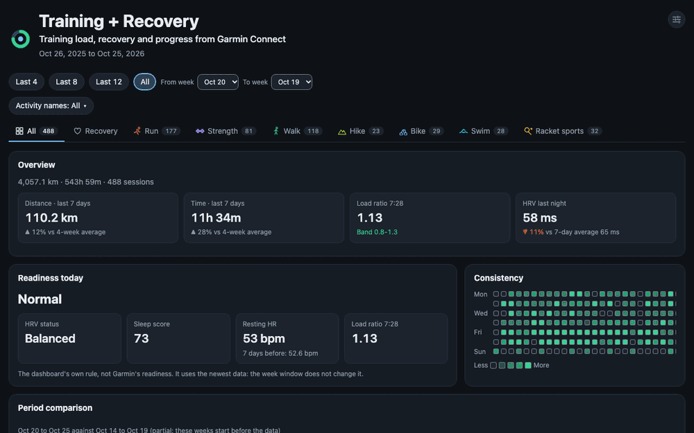

<h1 align="center">
  
  garmin-personal-mcp
</h1>

<p align="center"><b>Ask Claude, Codex or another AI assistant about your Garmin training, and get a training dashboard, also inside the chat. Official Personal API, read-only, runs with one command.</b></p>

<p align="center">
  🌐 <a href="https://garmin-personal-mcp.indaco.dev/"><b>Website</b></a> &nbsp;&middot;&nbsp; 👉
  <a href="https://garmin-personal-mcp.indaco.dev/demo/"><b>Try the live demo</b></a>
</p>

<p align="center">
  <a href="https://mcpservers.org/servers/indaco/garmin-personal-mcp"></a>
  <a href="https://glama.ai/mcp/servers/indaco/garmin-personal-mcp"></a>
  <a href="https://www.npmjs.com/package/@indaco/garmin-personal-mcp"></a>
  <a href="https://codecov.io/gh/indaco/garmin-personal-mcp"></a>
  <a href="https://nodejs.org"></a>
  <a href="tsconfig.json"></a>
  <a href="https://modelcontextprotocol.io"></a>
  <a href="https://developer.garmin.com/gc-developer-program/personal/"></a>
  <a href="LICENSE"></a>
  <a href="https://www.jetify.com/devbox/docs/contributor-quickstart/"></a>
</p>

<p align="center">
  <b><a href="#quick-start">Quick start</a></b> &middot;
  <b><a href="#what-you-can-ask">What you can ask</a></b> &middot;
  <b><a href="#tools">Tools</a></b> &middot;
  <b><a href="#dashboard">Dashboard</a></b> &middot;
  <b><a href="#dashboard-in-the-chat">Dashboard in the chat</a></b> &middot;
  <b><a href="guide/README.md">Guide</a></b>
</p>

<p align="center">
  An MCP server: a small program that your AI app starts on your computer, so that the assistant
  can read your Garmin data. Activities, laps, strength sets, sleep, HRV and more. Ask questions in
  your own words, or get a training dashboard: as a page file, or inside the chat in Claude Desktop.
</p>

<p align="center">
  
</p>
<p align="center">
  <sub><i>One thing you can build: the training dashboard, with demo data.</i></sub>
</p>

## What you can ask

Ask your assistant anything about your Garmin data, in your own words and in any language. The
assistant chooses the tools and can combine their data. Some examples:

- Activities: "List my last 5 activities, with pace and heart rate."
- Activities: "How much time did I spend in each HR zone on my runs this month?"
- Activities: "How did my sessions named Tempo 5k and Long run change over the last 2 months?"
- Laps: "Show the laps of my last run."
- Bike: "Compare the grit and flow of my last mountain-bike rides."
- Bike: "How many metres per hour did I climb on my last 5 rides?"
- Bike: "How much of my riding time was in Z1-2 and how much in Z4-5 over my last 5 rides?"
- Strength: "Compare my sets of this week with the week before."
- Strength: "Which muscles did I train most this week?"
- Strength: "What was my heaviest squat set this month, and what 1RM does it suggest?"
- Strength: "Which of my lifts have stalled over the last 6 weeks?"
- Strength: "How long did I rest between sets in my last strength session?"
- Strength: "How much weight did I lift in total in each strength session this month?"
- Workouts: "Did I do the reps and rests my workout planned?"
- Recovery: "How did I sleep this week, and how was my HRV?"
- Recovery: "Should I train hard today?"
- Recovery: "Show my steps, stress and Body Battery for the last 7 days."
- Recovery: "Did my Body Battery recover overnight this week, and which days drained it most?"
- Body: "How has my weight changed over the last 3 months?"
- All together: "My run on Saturday felt hard. Compare it with my sleep and HRV of the nights
  before."

## Features

- **Official and read-only**: uses the Garmin Connect Personal API, writes nothing back, and runs
  with `npx`.
- **All of your data**: laps and strength sets from the original .FIT files, with the muscles of
  each set; HRV, sleep, heart rate, stress and Body Battery; [`garminGet`](#tools) for the other
  endpoints.
- **All stdio clients**: Claude Desktop, Claude Code, Codex and the other MCP clients that use
  stdio. Tested with Claude Desktop and Claude Code.
- **A dashboard in less than a minute**: your training load next to recovery, for you or for your
  coach, with your own widgets and languages. See [Dashboard](#dashboard).
- **The dashboard in the chat**: in Claude Desktop, ask "show my training dashboard" and the page
  opens in the reply, with new data. See [Dashboard in the chat](#dashboard-in-the-chat).
- **Coach prompts**: a review of one run, strength session, swim or ride against its planned
  workout, a review of the week, a readiness check before a race or a swim event, and a check of
  today. See [Coach prompts](#coach-prompts).

## Quick start

You need [Node.js](https://nodejs.org) 22 or later (`node --version` shows the version) and a
Garmin Connect account with access to the
[Personal API](https://developer.garmin.com/gc-developer-program/personal/).

You do not use a terminal? Follow the
[step-by-step setup in Claude Desktop](guide/setup-claude-desktop.md).

### 1. Create a personal API key

1. Open Garmin Connect web at <https://connect.garmin.com/app/settings/personalApiToken>.
2. Select _Create Key_, accept the terms, select the expiry (1 year at most) and select _Create_.
3. Garmin shows the key **only one time**. Save it with the `setup` command. Paste the key at the
   prompt: it stays hidden. `setup` tests the key with Garmin and saves it in a file that only you
   can read (default `~/.config/garmin-mcp/api-key`, in your user folder on Windows):

```bash
npx -y @indaco/garmin-personal-mcp@latest setup
```

`setup` runs on macOS, Linux and Windows, and CI tests it on each one.

You can also give the key in `GARMIN_PERSONAL_API_KEY`, in the `env` block of the client
configuration ([example](guide/setup-claude-desktop.md#4-add-the-server-to-the-configuration-file)).
Claude Desktop does not read your shell profile. The
[automatic dashboard refresh](guide/dashboard.md#update-the-dashboard-on-a-schedule)
reads only the key file.

### 2. Connect your client

**Claude Desktop**: select Settings → Developer → _Edit Config_. Add a top-level `mcpServers` key
next to the keys that the file has, not in `preferences`
([example](guide/setup-claude-desktop.md#4-add-the-server-to-the-configuration-file)):

```json
{
  "mcpServers": {
    "garmin-personal": {
      "command": "npx",
      "args": ["-y", "@indaco/garmin-personal-mcp@latest"]
    }
  }
}
```

Then quit Claude Desktop **fully**, including the tray icon, and start it again. Settings →
Developer shows garmin-personal.

**Claude Code**: this command adds the server to all your projects:

```bash
claude mcp add garmin-personal --scope user -- npx -y @indaco/garmin-personal-mcp@latest
claude mcp list          # garmin-personal: ... ✔ Connected
```

Use `--scope project` to write a `.mcp.json` file that you can share in the current repository.

**Codex**: add this table to `~/.codex/config.toml`. The first `npx` download can take longer than
the default start time, so the table sets a longer one:

```toml
[mcp_servers.garmin-personal]
command = "npx"
args = ["-y", "@indaco/garmin-personal-mcp@latest"]
startup_timeout_sec = 60
```

Codex does not send your shell environment to the server. Use the key file, or add
`env = { GARMIN_PERSONAL_API_KEY = "..." }` to the table. The automatic dashboard refresh
needs the key file.

**Other clients** (Gemini CLI, VS Code, Cursor and others): in the MCP configuration of the client,
set the command `npx` and the arguments `-y @indaco/garmin-personal-mcp@latest`. Some clients do not
show MCP prompts. In these clients, ask for the dashboard in your own words. The tools are the same.

### 3. Ask your assistant

Start a new chat (Claude Desktop) or a new session (Claude Code). Ask "list my last 5 activities".
The first time that a garmin-personal tool asks for permission, answer **Allow always** in Claude
Desktop. In Claude Code, use `/permissions` and add `mcp__garmin-personal`.

## Tools

| Tool                       | What it gives                                                                                                                                                                                                                                         |
| -------------------------- | ----------------------------------------------------------------------------------------------------------------------------------------------------------------------------------------------------------------------------------------------------- |
| `listActivities`           | each activity with pace, HR, load and effect, by date, type or name                                                                                                                                                                                   |
| `getActivity`              | the details of one activity                                                                                                                                                                                                                           |
| `getActivityLaps`          | the laps of an activity, from its .FIT file; for a run also the half split, HR drift, the fade of each step, and hit or miss per plan step; for a swim also metres, pace per 100 m, stroke, lengths, SWOLF, strokes and the fade of each repeated set |
| `getActivitySets`          | the strength sets of an activity, with the muscles, the top set and the e1RM, and the planned workout against the done sets, with the planned rest, from its .FIT file                                                                                |
| `getActivityWorkouts`      | the planned workout of an activity as it is now in Garmin Connect: steps, targets and notes                                                                                                                                                           |
| `downloadActivityFit`      | saves the .FIT file of an activity in the data folder                                                                                                                                                                                                 |
| `getHrvRange`              | HRV during the night                                                                                                                                                                                                                                  |
| `getDailyHeartRate`        | the heart rate of a day, with the resting HR                                                                                                                                                                                                          |
| `getSleep`                 | the sleep of a night, or of up to 14 nights: hours, phases, score and need                                                                                                                                                                            |
| `getWeight`                | weight and body composition for a range of dates                                                                                                                                                                                                      |
| `getBodyBattery`           | how Body Battery charged and drained, for up to 14 days                                                                                                                                                                                               |
| `getHeartRateZones`        | your HR zones                                                                                                                                                                                                                                         |
| `getFitnessAge`            | fitness age against actual age                                                                                                                                                                                                                        |
| `getDailySummary`          | steps, stress and Body Battery, for a day or a range                                                                                                                                                                                                  |
| `getDashboardData`         | all the dashboard data in one call, with the server's totals and a local cache                                                                                                                                                                        |
| `writeDashboard`           | writes the dashboard page                                                                                                                                                                                                                             |
| `editDashboard`            | changes the layout, the custom widgets and the languages of the page                                                                                                                                                                                  |
| `showDashboard`            | shows the dashboard inside the chat, in Claude Desktop                                                                                                                                                                                                |
| `scheduleDashboardRefresh` | updates a dashboard page automatically, at the times you say in your own words                                                                                                                                                                        |
| `garminGet`                | all other GET endpoints of the Personal API                                                                                                                                                                                                           |

[Tools](guide/tools.md) gives the endpoints, the details of each tool and the data that the
Personal API does not have.

## Dashboard

The server makes a training dashboard with these prompts. In Claude Desktop, the prompts are in
the **+** menu of the message box, under _garmin-personal_. In Claude Code, they are slash commands:
use the full name, `/mcp__garmin-personal__<prompt>`. The short form `/garmin-personal:<prompt>` can
reach the assistant as the command name only, without the prompt.

| Prompt                                                  | What it does                                                                              | Claude Code example                                       |
| ------------------------------------------------------- | ----------------------------------------------------------------------------------------- | --------------------------------------------------------- |
| [training-dashboard](#training-dashboard)               | makes the page                                                                            | `/mcp__garmin-personal__training-dashboard 8`             |
| [training-dashboard-update](#training-dashboard-update) | adds the new data, your layout stays                                                      | `/mcp__garmin-personal__training-dashboard-update`        |
| [dashboard-setup](#dashboard-setup)                     | makes a page for you or for your coach, with only the sports and the data that you select | `/mcp__garmin-personal__dashboard-setup`                  |
| [dashboard-widget](#dashboard-widget)                   | makes a new widget from your idea                                                         | `/mcp__garmin-personal__dashboard-widget my longest ride` |
| [dashboard-language](#dashboard-language)               | adds a language to the page                                                               | `/mcp__garmin-personal__dashboard-language Dutch`         |

The prompts remove all spaces around an argument, also the no-break space from a phone keyboard.

### training-dashboard

The server writes the dashboard page from its template, and the assistant writes the coach notes.
The page is one HTML file, `garmin-dashboard.html` in the data folder. A page from the template
works offline. A freeform page loads Chart.js from the web.

| Argument | Values                            | Default  |
| -------- | --------------------------------- | -------- |
| `weeks`  | 1 to 52 (a larger value gives 52) | 12       |
| `layout` | `preset`, `blank` or `freeform`   | `preset` |

- `preset` gives the built-in widgets on each board.
- `blank` gives empty boards: you add the widgets that you want.
- `freeform` lets the assistant design the whole page. This takes much longer, and each page looks
  different.

In Claude Code, the arguments are in order and separated by spaces: first `weeks`, then `layout`.
You can also give only the layout: `/mcp__garmin-personal__training-dashboard freeform`.

The assistant gives you the path of the page and the command to open it. The page has a board for
all your training, a Recovery board and a board for each sport. A missing value shows as "n/a".

When your runs repeat a name, for example the "Tempo Run" of a training plan, the assistant asks
whether to compare those workouts across weeks. The default is no. A yes adds the Workout trend
widget. The server downloads the laps of the last 8 runs of each workout once and keeps them, so
the comparison grows with each update. See
[Page settings](guide/dashboard.md#page-settings).

The assistant also asks whether to add the Recovery trend. The default is no. A yes adds a widget
with the weekly average of sleep, sleep score and resting HR for the whole period, and the file then
holds these values for each day. See [Page settings](guide/dashboard.md#page-settings).

[The dashboard guide](guide/dashboard.md) tells about the title and the headline, the boards, the
themes and languages, the units and the activity-name filter, and how to change the layout.
[The widget catalogue](guide/widgets.md) lists every widget.

### training-dashboard-update

This prompt replaces the data and the coach notes of the page. Your layout, your custom widgets and
your languages stay. Only a new preset widget of a release can join a board that you edited, one
time. Reload the page to see the new data.

| Argument | Values                                                                  | Default                 |
| -------- | ----------------------------------------------------------------------- | ----------------------- |
| `weeks`  | the weeks to cover                                                      | the weeks of the page   |
| `path`   | the dashboard file, for example `garmin-dashboard-coach.html` (`.html`) | `garmin-dashboard.html` |

In Claude Code: `/mcp__garmin-personal__training-dashboard-update coach.html` updates `coach.html`. A
value that ends in `.html` is the file, also in the first place.

To update the data without coach notes, see
[Update the dashboard](guide/dashboard.md#update-the-dashboard).

After a release, this prompt also writes the new page code. Restart the client first. See
[Update the page code after a release](guide/dashboard.md#update-the-page-code-after-a-release).

To update the page automatically, tell your assistant when, in your own words, for example "update
my dashboard every Monday at 7". See
[Update the dashboard on a schedule](guide/dashboard.md#update-the-dashboard-on-a-schedule).

### dashboard-setup

The assistant asks you some questions, then writes a page with your answers. First, it asks who the
page is for:

- **Personal**: a page for you, with all your data.
- **Shared**: a page for your coach or personal trainer. You select each type of data to include,
  for example HR zones yes, fitness age and sleep no.

Then the assistant asks for the file (any name or path), the title, the headline, the sports, the
languages and the themes, and whether to compare the workouts that your runs repeat. A page can also keep the sleep and resting HR of the whole period (`recoveryHistory`, off by default). The server writes only the data that you select into the file. Other data
is not in the file, so you can send the file safely. A personal page and a shared page can be two
files side by side. Each page keeps its settings on each update. The argument `weeks` is optional
(default 12).

[Page settings](guide/dashboard.md#page-settings) tells more.

### dashboard-widget

This prompt makes a new widget from your idea, for example "my longest ride of each month". The
assistant writes a small widget, and `editDashboard` stores it in the page and in your widget
library (`widgets.json` in the data folder). The widget stays after each update, and each new page
gets it too. The argument `idea` is required. The argument `path` is optional: it is the file of the
page, for example `coach.html`. In Claude Code:
`/mcp__garmin-personal__dashboard-widget my longest ride each month coach.html`. Reload the page to see
the widget.
[Custom widgets](guide/custom-widgets.md) tells more.

### dashboard-language

This prompt adds a language to the dashboard. The assistant translates the texts of the page, and
`editDashboard` stores them in the page. The argument `language` is optional: the default is the
language of the conversation. The argument `path` is optional: it is the file of the page, for
example `coach.html`. In Claude Code: `/mcp__garmin-personal__dashboard-language Dutch coach.html`.
A text without a translation shows in English. To remove an added language, ask your assistant to
remove it: `editDashboard` with `removeLanguages`.
[Languages](guide/languages.md) tells more.

### Presets or freeform

In many setup guides for Claude and Garmin, Claude reads the data and writes the whole dashboard
page. With a preset, the server writes the page from a tested template, and the assistant writes
only the coach notes. My measurements for a first build, with Claude Code and Opus
(other clients and models give other times and costs):

| First build            | Time         | Cost         |
| ---------------------- | ------------ | ------------ |
| Preset                 | 34 s         | $0.16        |
| Claude writes the page | 24 to 35 min | $6.6 to $9.2 |

For a design of your own, use `layout` = `freeform`: the assistant writes the page, as in those
guides.

[Presets or freeform](guide/presets.md) gives the measurements and the limits of the presets.

## Dashboard in the chat

In Claude Desktop, the dashboard can open inside the chat, with its boards, charts and themes. You
do not open a file or a browser. There is no prompt to run: ask in your own words, for example:

- "Show my training dashboard in the chat."
- "Show my dashboard in the chat for the last 26 weeks."
- "Show garmin-dashboard-coach.html in the chat."

The assistant calls `showDashboard`. The tool reads new data from Garmin and shows your saved page,
with its layout, custom widgets, languages and settings. It writes no file, and the page has no
coach notes.

| Client                                                | What you get                                                             |
| ----------------------------------------------------- | ------------------------------------------------------------------------ |
| Claude Desktop                                        | the page in the chat (tested)                                            |
| Claude Code, the Codex CLI and other terminal clients | a short text reply. Run `training-dashboard` to write the page as a file |
| Codex in the ChatGPT desktop app                      | not tested yet                                                           |
| The ChatGPT chat, Claude on the web                   | not available: they connect only to servers on the internet              |

The page in the chat is an MCP App. Other clients that show MCP Apps can also work, but they are not
tested. [Show the dashboard in the chat](guide/dashboard.md#show-the-dashboard-in-the-chat) gives
the limits.

## Coach prompts

These prompts answer in the chat. They do not change a dashboard.

| Prompt                              | What it does                                                | Claude Code example                                             |
| ----------------------------------- | ----------------------------------------------------------- | --------------------------------------------------------------- |
| [run-review](#run-review)           | reviews one run as a coach                                  | `/mcp__garmin-personal__run-review`                             |
| [race-readiness](#race-readiness)   | tells if you are ready for a race, with a plan for its pace | `/mcp__garmin-personal__race-readiness 2026-11-15 half 1:45:00` |
| [strength-review](#strength-review) | reviews one strength session as a coach                     | `/mcp__garmin-personal__strength-review`                        |
| [swim-review](#swim-review)         | reviews one swim as a coach                                 | `/mcp__garmin-personal__swim-review`                            |
| [swim-readiness](#swim-readiness)   | tells if you are ready for a swim event                     | `/mcp__garmin-personal__swim-readiness 2026-08-01 1.9 km`       |
| [ride-review](#ride-review)         | reviews one ride as a coach                                 | `/mcp__garmin-personal__ride-review`                            |
| [train-today](#train-today)         | tells if you should train hard today, with fitness and form | `/mcp__garmin-personal__train-today`                            |
| [week-review](#week-review)         | reviews your last whole week against the weeks before       | `/mcp__garmin-personal__week-review`                            |

A missing value shows as "n/a": the assistant does not estimate it.

### run-review

The assistant compares the planned workout that your watch ran with the laps of the run: the target,
what the lap did, and hit or miss. The server finds hit or miss from the run's .FIT file, so two
reviews of one run give the same result. For intervals, it gives the fade from the first rep to the
last. For a steady run, it gives the HR drift: the drop in distance per heartbeat from the first
half to the second half. It ends with the sleep and HRV of the night after the run, and a short
coach note.

| Argument   | Values                                                     | Default      |
| ---------- | ---------------------------------------------------------- | ------------ |
| `activity` | an activity id, or words of the activity name (`Long Run`) | the last run |

### race-readiness

The assistant reads the server's summary of 12 weeks (a `writeDashboard` preview, which writes
nothing). It has the weekly run distance and load, the long runs with their pace split and HR drift,
the aerobic efficiency (distance per heartbeat of the easy runs, last 4 weeks against the first 4)
and the race predictions, as the dashboard computes them. The assistant gives the days to the race
and these numbers, and tells whether your load drops in the last 2 weeks (the taper). The race
prediction uses your best efforts of 5 km or more (Riegel, an estimate: the fastest prediction
counts). The assistant compares it with your goal and checks the HRV and sleep of the last 7
nights. It ends with a target pace for each quarter of the race.

| Argument   | Values                                         | Default                  |
| ---------- | ---------------------------------------------- | ------------------------ |
| `date`     | the race date, `yyyy-MM-dd`                    | none: the assistant asks |
| `distance` | `5k`, `10k`, `half`, `marathon`, or a distance | none: the assistant asks |
| `goal`     | your goal time, for example `1:45:00`          | no goal: prediction only |

In Claude Code, give the values in any order: a value in the form `yyyy-MM-dd` is the date, a value
in the form `1:45:00` is the goal, and the other words are the distance. For example
`/mcp__garmin-personal__race-readiness half marathon 2026-11-15`.

### strength-review

The assistant compares the planned workout that your watch ran with the sets you did: the planned
sets and reps of each exercise, what you did, and hit or miss. The server finds hit or miss from the
session's .FIT file, so two reviews of one session give the same result. Garmin plans no weights, so
the plan shows none. For each
exercise it gives the top set and its estimated 1RM against the previous session of the same name,
and the rep drop from the first set to the last at the same weight. It compares your rest with the
planned rest, and ends with the sleep and HRV of the night after the session, and a short coach note.

| Argument   | Values                                                       | Default                   |
| ---------- | ------------------------------------------------------------ | ------------------------- |
| `activity` | an activity id, or words of the activity name (`Upper Body`) | the last strength session |

### swim-review

The assistant gives the summary of one swim, and keeps pool and open water apart. For a pool swim it
shows each interval: distance, stroke, pace per 100 m, SWOLF, strokes and the rest after it. For each
repeated set it shows the pace and SWOLF of the first and the last repeat, and the fade in %. It
shows the planned workout beside the laps, without hit or miss, and ends with the sleep and HRV of
the night after the swim, and a short coach note. It does not judge a swim on heart rate alone.

| Argument   | Values                                                    | Default       |
| ---------- | --------------------------------------------------------- | ------------- |
| `activity` | an activity id, or words of the activity name (`Morning`) | the last swim |

The prompt needs one .FIT file. A set is laps in a row of one distance, stroke and intensity. Two
sets of the same distance, stroke and intensity read as one.

### swim-readiness

The assistant reads the server's summary of 12 weeks (a `writeDashboard` preview, which writes
nothing). It gives the days to the event, the swims and km of each week, the longest swim against
the event distance, and your recent pace, with pool and open water in separate tables. For the pool
it compares your last swims with as many before them, in one pool length. It ends with your load,
HRV and sleep, and a short verdict. It gives no predicted time.

| Argument   | Values                                   | Default                  |
| ---------- | ---------------------------------------- | ------------------------ |
| `date`     | the event date, `yyyy-MM-dd`             | none: the assistant asks |
| `distance` | the event distance, for example `1.9 km` | none: the assistant asks |
| `tests`    | your 200 m and 400 m times, `3:10 6:40`  | no CSS                   |

CSS (critical swim speed) shows only when you give both test times, from all-out swims on one day. The
server computes it: (400 m time - 200 m time) / 2. It is never estimated from your swims.

In Claude Code, give the values in any order: a value in the form `yyyy-MM-dd` is the date, values in
the form `3:10` are the test times (the larger one is the 400 m), and the other words are the
distance. For example `/mcp__garmin-personal__swim-readiness 1.9 km 2026-08-01 3:10 6:40`.

### ride-review

The assistant gives the summary of one ride: distance, moving time, speed, ascent and ascent per
hour, heart rate, training effect and load, and the time in the easy and hard HR zones. It shows the
power only when the ride has power data, and the grit and flow of a mountain-bike ride. It shows the
planned workout beside the laps, without hit or miss, and a table of the laps. It compares the ride
with your earlier rides of the same name and a similar distance, among the 200 activities before it,
because a hillier route changes speed and climbing at the same fitness. It ends with the sleep and
HRV of the night after the ride, and a short coach note.

| Argument   | Values                                                       | Default       |
| ---------- | ------------------------------------------------------------ | ------------- |
| `activity` | an activity id, or words of the activity name (`Trail Loop`) | the last ride |

The laps need one .FIT file. Not checked on real data: power, a planned ride, an earlier ride of the
same name, and the laps of a mountain-bike or indoor ride.

### train-today

The assistant reads the server's summary of the dashboard data (a `writeDashboard` preview, which
writes nothing). It uses the weeks of your dashboard page, so the numbers are the same as on the
page. It gives the verdict of the dashboard's Readiness widget: go easy, normal or ready to push.
This verdict is the dashboard's own rule, not Garmin's Training Readiness. A table shows each input
and the rule it meets: the HRV status, the sleep score, the resting HR against the average of the
7 days before, and the load ratio of 7 to 28 days. When a value is from an older night, the
assistant gives its date. Then it gives your fitness, fatigue and form, and a short coach note.

Without HRV and sleep data, for example when the page leaves out the recovery data, the summary has
no readiness: the verdict and its inputs show as "n/a". The prompt has no arguments.

### week-review

The assistant reads the server's summary of the dashboard data (a `writeDashboard` preview, which
writes nothing). It uses the weeks of your dashboard page, so the numbers are the same as on the
page. It compares your last whole week, Monday to Sunday, with up to 4 weeks before it: sessions,
hours, km, run km and load, and the load ramp against the week before (above 10% is the page's
warning level). Then it gives the load ratio, the monotony and strain of the last 7 days and the
form of today, and the new run bests of the week with the time each one beat. These are bests since the
page's first week, not all-time records: a faster run before that week is not counted. It gives the planned strength exercises hit and missed in the week, and the exercises that miss most. These count only the sessions you did: a skipped planned session leaves no file and is not seen. It gives the laps of the week's runs on the planned target and off it, the drills that miss most, and how many runs it could not read (the page setting `workouts` reads more of them). It ends with a short coach note. The summary has no split by sport for each week, so the review has none. The prompt has no
arguments.

## Configuration

All the settings are environment variables, and all of them are optional.

| Variable                  | Default                                  | Meaning                                                                                            |
| ------------------------- | ---------------------------------------- | -------------------------------------------------------------------------------------------------- |
| `GARMIN_PERSONAL_API_KEY` | not set                                  | the personal API key. It has priority over the key file. The automatic refresh needs the key file. |
| `GARMIN_API_KEY_FILE`     | `~/.config/garmin-mcp/api-key`           | the file with the API key                                                                          |
| `GARMIN_DATA_DIR`         | `~/workspace/garmin-data`                | the data folder                                                                                    |
| `GARMIN_BASE_URL`         | `https://personal.connectapi.garmin.com` | the Personal API host                                                                              |

To set a variable in Claude Desktop, add an `env` object next to `args`:

```json
"env": { "GARMIN_DATA_DIR": "/absolute/path/to/garmin-data" }
```

In Claude Code, add `--env GARMIN_DATA_DIR=/path/to/garmin-data` to `claude mcp add`.

[The data folder](guide/tools.md#the-data-folder) lists the files that the server keeps and its
log.

## Commands

The server is also a command for a terminal. A command does one task and stops: it does not start
the MCP server.

| Command                                  | What it does                                                                     |
| ---------------------------------------- | -------------------------------------------------------------------------------- |
| `info`                                   | shows the version, the settings and where the files are. It never shows the key. |
| `doctor`                                 | tests the API key, the folders and the schedule. It never shows the key.         |
| `setup [--force]`                        | tests the API key and saves it in a file that only you can read                  |
| `refresh [page.html]`                    | updates a dashboard page one time                                                |
| `schedule [daily\|weekdays\|weekly ...]` | shows, sets or stops the automatic update of a page                              |
| `--version`, `-v`                        | shows the version                                                                |
| `--help`, `-h`                           | lists the commands. After a command, it shows the help of that command.          |

```bash
npx -y @indaco/garmin-personal-mcp@latest info
```

A command reads the environment variables of your terminal, not of your MCP client configuration.
[Commands](guide/cli.md) has each command, its output and its exit codes.

## Security

The server is read-only. It sends the API key only to the Garmin token endpoint, and it never logs
or returns the key or the access token. It refuses a key that has spaces or line breaks in it, and
it removes the key and the token from network error messages. If you saw your API key in a chat,
revoke the key on the [API key page](https://connect.garmin.com/app/settings/personalApiToken) and
create a new one. No tool result has your Garmin user id, name or profile image, or the ids of
your devices and daily records, also with `raw` and `garminGet`. Your .FIT files can have your GPS
track, so keep the data folder private.

[SECURITY.md](SECURITY.md) tells how the server protects your data and how to report a
vulnerability. Do not open a public issue for a vulnerability.

The Personal API is for personal use that is not commercial, under the terms of Garmin. Garmin
does not endorse this project, and the project has no affiliation with Garmin.

## Problems and solutions

| Problem                            | Solution                                                                                                                             |
| ---------------------------------- | ------------------------------------------------------------------------------------------------------------------------------------ |
| The server does not start          | Make sure that Node.js is version 22 or later: `node --version`.                                                                     |
| Claude Desktop does not find `npx` | GUI apps do not read your shell profile. Use the absolute path of `npx` (`which npx`) as the `command`.                              |
| Changes have no effect             | The client keeps the old server process. Restart the client: a new Claude Code session, or quit and start Claude Desktop again.      |
| Which version runs                 | `npx -y @indaco/garmin-personal-mcp@latest --version` (or `-v`) prints the version and stops. `--help` (or `-h`) lists the commands. |
| Where the files are                | `npx -y @indaco/garmin-personal-mcp@latest info` shows the key file, the data folder and the logs. See [Commands](guide/cli.md).     |

[Problems and solutions](guide/troubleshooting.md) has more problems, the log files, and commands
that test the key and the server.

## Contributing

Read [CONTRIBUTING.md](CONTRIBUTING.md). It tells how to run the server from source, and it has
the commands, the test rules and the code map.

To build the website with its demo dashboard (a year of sample data), run `pnpm build:all`. The
site is in `dist-site/`, and the demo in `dist-site/demo/index.html`.

## Credits

The idea comes from [apratico/garmin-mcp](https://github.com/apratico/garmin-mcp) by Alessandro
Praticò: a Java MCP server for the Garmin Personal API, where Claude writes the dashboard. I
tested it in a fork, [indaco/garmin-mcp](https://github.com/indaco/garmin-mcp), and then made this
server as a different solution. It runs with `npx`, without Java, and it writes the dashboard page
from a tested template.

This server uses the same key file as indaco/garmin-mcp and can share its data folder.

## How this was built

AI agents in Claude Code wrote the code, tests and docs of this project. I chose the design,
reviewed each change and tested the server with my own Garmin data. The rules that the agents
follow are in [AGENTS.md](AGENTS.md).

## License

This project uses the [MIT License](LICENSE). `dist/index.js` and the dashboard page include
other libraries with their own licenses: [THIRD-PARTY-NOTICES.md](THIRD-PARTY-NOTICES.md) lists them.
