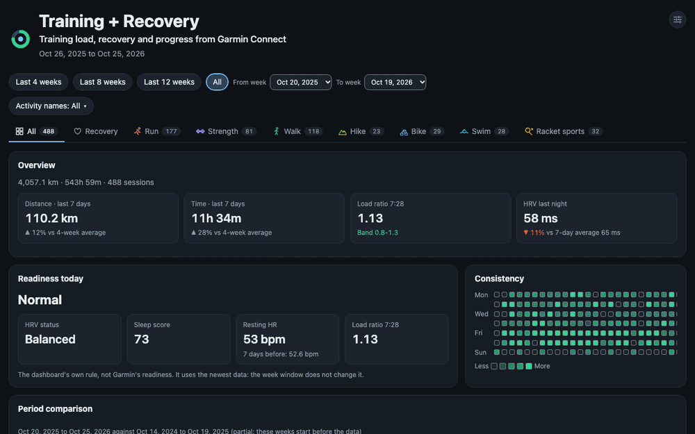

<h1 align="center">
  
  garmin-personal-mcp
</h1>

<p align="center"><b>Ask your AI assistant about your Garmin training in your own words, then get a training dashboard of it.</b></p>

<p align="center">
  👉 <a href="https://garmin-personal-mcp.indaco.dev/demo/"><b>Live demo</b></a> &middot;
  <b><a href="#quick-start">Quick start</a></b> &middot;
  <b><a href="guide/setup-claude-desktop.md">No terminal? Claude Desktop setup</a></b> &middot;
  🌐 <a href="https://garmin-personal-mcp.indaco.dev/"><b>Website</b></a> &middot;
  <b><a href="guide/README.md">Guide</a></b>
</p>

<p align="center">
  <a href="https://www.npmjs.com/package/@indaco/garmin-personal-mcp"></a>
  <a href="https://glama.ai/mcp/servers/indaco/garmin-personal-mcp"></a>
  <a href="https://codecov.io/gh/indaco/garmin-personal-mcp"></a>
  <a href="LICENSE"></a>
  <a href="https://mcpservers.org/servers/indaco/garmin-personal-mcp"></a>
  <a href="https://www.jetify.com/devbox/docs/contributor-quickstart/"></a>
</p>

This is an MCP server: a small program that your AI app starts on your computer, so that the
assistant can read your Garmin data. Activities, laps, strength sets, sleep, HRV and more. Ask
questions in your own words, or get a training dashboard: as a page file, or inside the chat in
Claude Desktop.

- **Official**: it uses the Garmin Connect Personal API. Garmin does not endorse this project.
- **Read-only**: it writes nothing back to Garmin.
- **Your key**: the server sends the API key only to the Garmin token endpoint.
- **Tested with Claude Desktop and Claude Code.** Other MCP clients that use stdio, such as Codex,
  can connect.

<p align="center">
  
</p>
<p align="center">
  <sub><i>One thing you can build: the training dashboard, with demo data.</i></sub>
</p>

## What you can ask

Ask your assistant anything about your Garmin data, in your own words and in any language. The
assistant chooses the tools and can combine their data. Some examples:

- All together: "My run on Saturday felt hard. Compare it with my sleep and HRV of the nights
  before."
- Recovery: "Should I train hard today?"
- Activities: "List my last 5 activities, with pace and heart rate."
- Laps: "Show the laps of my last run."
- Bike: "Compare the grit and flow of my last mountain-bike rides."
- Strength: "Which of my lifts have stalled over the last 6 weeks?"
- Workouts: "Did I do the reps and rests my workout planned?"
- Body: "How has my weight changed over the last 3 months?"

<details>
<summary><b>12 more questions</b></summary>

- Activities: "How much time did I spend in each HR zone on my runs this month?"
- Activities: "How did my sessions named Tempo 5k and Long run change over the last 2 months?"
- Bike: "How many metres per hour did I climb on my last 5 rides?"
- Bike: "How much of my riding time was in Z1-2 and how much in Z4-5 over my last 5 rides?"
- Strength: "Compare my sets of this week with the week before."
- Strength: "Which muscles did I train most this week?"
- Strength: "What was my heaviest squat set this month, and what 1RM does it suggest?"
- Strength: "How long did I rest between sets in my last strength session?"
- Strength: "How much weight did I lift in total in each strength session this month?"
- Recovery: "How did I sleep this week, and how was my HRV?"
- Recovery: "Show my steps, stress and Body Battery for the last 7 days."
- Recovery: "Did my Body Battery recover overnight this week, and which days drained it most?"

</details>

## Features

- **All of your data**: laps and strength sets from the original .FIT files, with the muscles of
  each set; HRV, sleep, heart rate, stress and Body Battery; [`garminGet`](#tools) for the other
  endpoints.
- **A dashboard in less than a minute**: your training load next to recovery, for you or for your
  coach, with your own widgets and languages. See [Dashboard](#dashboard).
- **The dashboard in the chat**: in Claude Desktop, ask "show my training dashboard" and the page
  opens in the reply, with new data. See [Dashboard in the chat](#dashboard-in-the-chat).
- **Coach prompts**: a review of one run, strength session, swim or ride against its planned
  workout, a review of the week or of the calendar year, a readiness check before a race or a swim
  event, and a check of today. See [Coach prompts](#coach-prompts).

## Quick start

You need [Node.js](https://nodejs.org) 22 or later (`node --version` shows the version) and a
Garmin Connect account with access to the
[Personal API](https://developer.garmin.com/gc-developer-program/personal/).

You do not use a terminal? Follow the
[step-by-step setup in Claude Desktop](guide/setup-claude-desktop.md).

### 1. Create a personal API key

1. Open Garmin Connect web at <https://connect.garmin.com/app/settings/personalApiToken>.
2. Select _Create Key_, accept the terms, select the expiry (1 year at most) and select _Create_.
3. Garmin shows the key **only one time**. Save it with the `setup` command. Paste the key at the
   prompt: it stays hidden. `setup` tests the key with Garmin and saves it in a file that only you
   can read (default `~/.config/garmin-mcp/api-key`, in your user folder on Windows):

```bash
npx -y @indaco/garmin-personal-mcp@latest setup
```

`setup` runs on macOS, Linux and Windows, and CI tests it on each one.

You can also give the key in `GARMIN_PERSONAL_API_KEY`, in the `env` block of the client
configuration ([example](guide/setup-claude-desktop.md#4-add-the-server-to-the-configuration-file)).
Claude Desktop does not read your shell profile. The
[automatic dashboard refresh](guide/dashboard.md#update-the-dashboard-on-a-schedule)
reads only the key file.

### 2. Connect your client

Each client starts the same command: `npx -y @indaco/garmin-personal-mcp@latest`. Most clients use
this `mcpServers` block in their MCP configuration:

```json
{
  "mcpServers": {
    "garmin-personal": {
      "command": "npx",
      "args": ["-y", "@indaco/garmin-personal-mcp@latest"]
    }
  }
}
```

<details>
<summary><b>Claude Desktop</b></summary>

Select Settings → Developer → _Edit Config_. Add the top-level `mcpServers` key from the block above
next to the keys that the file has, not in `preferences`
([example](guide/setup-claude-desktop.md#4-add-the-server-to-the-configuration-file)).

Then quit Claude Desktop **fully**, including the tray icon, and start it again. Settings →
Developer shows garmin-personal.

</details>

<details>
<summary><b>Claude Code</b></summary>

This command adds the server to all your projects:

```bash
claude mcp add garmin-personal --scope user -- npx -y @indaco/garmin-personal-mcp@latest
claude mcp list          # garmin-personal: ... ✔ Connected
```

Use `--scope project` to write a `.mcp.json` file that you can share in the current repository.

</details>

<details>
<summary><b>Codex</b></summary>

Add this table to `~/.codex/config.toml`. The first `npx` download can take longer than the default
start time, so the table sets a longer one:

```toml
[mcp_servers.garmin-personal]
command = "npx"
args = ["-y", "@indaco/garmin-personal-mcp@latest"]
startup_timeout_sec = 60
```

Codex does not send your shell environment to the server. Use the key file, or add
`env = { GARMIN_PERSONAL_API_KEY = "..." }` to the table. The automatic dashboard refresh needs the
key file.

</details>

<details>
<summary><b>Other clients</b> (Gemini CLI, VS Code, Cursor and others)</summary>

In the MCP configuration of the client, set the command `npx` and the arguments
`-y @indaco/garmin-personal-mcp@latest`. Some clients do not show MCP prompts. In these clients, ask
for the dashboard in your own words. The tools are the same.

</details>

### 3. Ask your assistant

Start a new chat (Claude Desktop) or a new session (Claude Code). Ask "list my last 5 activities".
The first time that a garmin-personal tool asks for permission, answer **Allow always** in Claude
Desktop. In Claude Code, use `/permissions` and add `mcp__garmin-personal`.

## Tools

| Tool                       | What it gives                                                                                                                                                                                                                                         |
| -------------------------- | ----------------------------------------------------------------------------------------------------------------------------------------------------------------------------------------------------------------------------------------------------- |
| `listActivities`           | each activity with pace, HR, load and effect, by date, type or name                                                                                                                                                                                   |
| `getActivity`              | the details of one activity                                                                                                                                                                                                                           |
| `getActivityLaps`          | the laps of an activity, from its .FIT file; for a run also the half split, HR drift, the fade of each step, and hit or miss per plan step; for a swim also metres, pace per 100 m, stroke, lengths, SWOLF, strokes and the fade of each repeated set |
| `getActivitySets`          | the strength sets of an activity, with the muscles, the top set and the e1RM, and the planned workout against the done sets, with the planned rest, from its .FIT file                                                                                |
| `getActivityWorkouts`      | the planned workout of an activity as it is now in Garmin Connect: steps, targets and notes                                                                                                                                                           |
| `downloadActivityFit`      | saves the .FIT file of an activity in the data folder                                                                                                                                                                                                 |
| `getHrvRange`              | HRV during the night                                                                                                                                                                                                                                  |
| `getDailyHeartRate`        | the heart rate of a day, with the resting HR                                                                                                                                                                                                          |
| `getSleep`                 | the sleep of a night, or of up to 14 nights: hours, phases, score and need                                                                                                                                                                            |
| `getWeight`                | weight and body composition for a range of dates                                                                                                                                                                                                      |
| `getBodyBattery`           | how Body Battery charged and drained, for up to 14 days                                                                                                                                                                                               |
| `getHeartRateZones`        | your HR zones                                                                                                                                                                                                                                         |
| `getFitnessAge`            | fitness age against actual age                                                                                                                                                                                                                        |
| `getDailySummary`          | steps, stress and Body Battery, for a day or a range                                                                                                                                                                                                  |
| `getDashboardData`         | all the dashboard data in one call, with the server's totals and a local cache                                                                                                                                                                        |
| `writeDashboard`           | writes the dashboard page                                                                                                                                                                                                                             |
| `editDashboard`            | changes the layout, the custom widgets and the languages of the page                                                                                                                                                                                  |
| `showDashboard`            | shows the dashboard inside the chat, in Claude Desktop                                                                                                                                                                                                |
| `scheduleDashboardRefresh` | updates a dashboard page automatically, at the times you say in your own words                                                                                                                                                                        |
| `getYearReview`            | the recap of a calendar year from the cache; it asks before it fetches the missing days                                                                                                                                                               |
| `garminGet`                | all other GET endpoints of the Personal API                                                                                                                                                                                                           |

[Tools](guide/tools.md) gives the endpoints, the details of each tool and the data that the
Personal API does not have.

## Dashboard

The server makes a training dashboard with these prompts. In Claude Desktop, the prompts are in
the **+** menu of the message box, under _garmin-personal_. In Claude Code, they are slash commands:
use the full name, `/mcp__garmin-personal__<prompt>`. The short form `/garmin-personal:<prompt>` can
reach the assistant as the command name only, without the prompt.

| Prompt                                                                  | What it does                                                                              | Claude Code example                                       |
| ----------------------------------------------------------------------- | ----------------------------------------------------------------------------------------- | --------------------------------------------------------- |
| [training-dashboard](guide/prompts.md#training-dashboard)               | makes the page                                                                            | `/mcp__garmin-personal__training-dashboard 8`             |
| [training-dashboard-update](guide/prompts.md#training-dashboard-update) | adds the new data, your layout stays                                                      | `/mcp__garmin-personal__training-dashboard-update`        |
| [dashboard-setup](guide/prompts.md#dashboard-setup)                     | makes a page for you or for your coach, with only the sports and the data that you select | `/mcp__garmin-personal__dashboard-setup`                  |
| [dashboard-widget](guide/prompts.md#dashboard-widget)                   | makes a new widget from your idea                                                         | `/mcp__garmin-personal__dashboard-widget my longest ride` |
| [dashboard-language](guide/prompts.md#dashboard-language)               | adds a language to the page                                                               | `/mcp__garmin-personal__dashboard-language Dutch`         |

[Prompts](guide/prompts.md#dashboard-prompts) has the arguments and the details of each prompt.

[The dashboard guide](guide/dashboard.md) tells about the title and the headline, the boards, the
themes and languages, the units and the activity-name filter, and how to change the layout.
[The widget catalogue](guide/widgets.md) lists every widget.

### Presets or freeform

In many setup guides for Claude and Garmin, Claude reads the data and writes the whole dashboard
page. With a preset, the server writes the page from a tested template, and the assistant writes
only the coach notes. My measurements for a first build, with Claude Code and Opus on synthetic
data (75 activities in 12 weeks; other clients and models give other times and costs):

| First build            | Time         | Cost         |
| ---------------------- | ------------ | ------------ |
| Preset                 | 34 s         | $0.16        |
| Claude writes the page | 24 to 35 min | $6.6 to $9.2 |

For a design of your own, use `layout` = `freeform`: the assistant writes the page, as in those
guides.

[Presets or freeform](guide/presets.md) gives the measurements and the limits of the presets.

## Dashboard in the chat

In Claude Desktop, the dashboard can open inside the chat, with its boards, charts and themes. You
do not open a file or a browser. There is no prompt to run: ask in your own words, for example:

- "Show my training dashboard in the chat."
- "Show my dashboard in the chat for the last 26 weeks."
- "Show garmin-dashboard-coach.html in the chat."

The assistant calls `showDashboard`. The tool reads new data from Garmin and shows your saved page,
with its layout, custom widgets, languages and settings. It writes no page file, and the page has no
coach notes.

| Client                                                | What you get                                                             |
| ----------------------------------------------------- | ------------------------------------------------------------------------ |
| Claude Desktop                                        | the page in the chat (tested)                                            |
| Claude Code, the Codex CLI and other terminal clients | a short text reply. Run `training-dashboard` to write the page as a file |
| Codex in the ChatGPT desktop app                      | not tested yet                                                           |
| The ChatGPT chat, Claude on the web                   | not available: they connect only to servers on the internet              |

The page in the chat is an MCP App. Other clients that show MCP Apps can also work, but they are not
tested. [Show the dashboard in the chat](guide/dashboard.md#show-the-dashboard-in-the-chat) gives
the limits.

## Year review

Ask, for example, "give me my year in review". `getYearReview` gives the recap of a calendar year in
the chat from the local cache, and asks before it fetches the missing days.
[Year review](guide/year-review.md) has its arguments, the answers of the form and the limits.

## Coach prompts

These prompts answer in the chat. They do not change a dashboard.

| Prompt                                                 | What it does                                                | Claude Code example                                             |
| ------------------------------------------------------ | ----------------------------------------------------------- | --------------------------------------------------------------- |
| [run-review](guide/prompts.md#run-review)              | reviews one run as a coach                                  | `/mcp__garmin-personal__run-review`                             |
| [race-readiness](guide/prompts.md#race-readiness)      | tells if you are ready for a race, with a plan for its pace | `/mcp__garmin-personal__race-readiness 2026-11-15 half 1:45:00` |
| [strength-review](guide/prompts.md#strength-review)    | reviews one strength session as a coach                     | `/mcp__garmin-personal__strength-review`                        |
| [swim-review](guide/prompts.md#swim-review)            | reviews one swim as a coach                                 | `/mcp__garmin-personal__swim-review`                            |
| [swim-readiness](guide/prompts.md#swim-readiness)      | tells if you are ready for a swim event                     | `/mcp__garmin-personal__swim-readiness 2026-08-01 1.9 km`       |
| [ride-review](guide/prompts.md#ride-review)            | reviews one ride as a coach                                 | `/mcp__garmin-personal__ride-review`                            |
| [train-today](guide/prompts.md#train-today)            | tells if you should train hard today, with fitness and form | `/mcp__garmin-personal__train-today`                            |
| [week-review](guide/prompts.md#week-review)            | reviews your last whole week against the weeks before       | `/mcp__garmin-personal__week-review`                            |
| [block-review](guide/prompts.md#block-review)          | reviews your last 4 to 12 whole weeks as one training block | `/mcp__garmin-personal__block-review 8`                         |
| [year-review](guide/year-review.md#year-review-prompt) | gives the recap of a calendar year                          | `/mcp__garmin-personal__year-review 2025`                       |

A missing value shows as "n/a": the assistant does not estimate it.

[Prompts](guide/prompts.md#coach-prompts) has the arguments of each prompt and what each one
compares.

## Configuration

All the settings are environment variables, and all of them are optional.

| Variable                  | Default                                  | Meaning                                                                                            |
| ------------------------- | ---------------------------------------- | -------------------------------------------------------------------------------------------------- |
| `GARMIN_PERSONAL_API_KEY` | not set                                  | the personal API key. It has priority over the key file. The automatic refresh needs the key file. |
| `GARMIN_API_KEY_FILE`     | `~/.config/garmin-mcp/api-key`           | the file with the API key                                                                          |
| `GARMIN_DATA_DIR`         | `~/workspace/garmin-data`                | the data folder                                                                                    |
| `GARMIN_BASE_URL`         | `https://personal.connectapi.garmin.com` | the Personal API host                                                                              |

To set a variable in Claude Desktop, add an `env` object next to `args`:

```json
"env": { "GARMIN_DATA_DIR": "/absolute/path/to/garmin-data" }
```

In Claude Code, add `--env GARMIN_DATA_DIR=/path/to/garmin-data` to `claude mcp add`.

[The data folder](guide/tools.md#the-data-folder) lists the files that the server keeps and its
log.

## Commands

The server is also a command for a terminal. A command does one task and stops: it does not start
the MCP server.

| Command                                  | What it does                                                                                    |
| ---------------------------------------- | ----------------------------------------------------------------------------------------------- |
| `info`                                   | shows the version, the settings, the files, the pages and the schedule. It never shows the key. |
| `doctor`                                 | tests the API key, folders, data files and the schedule. It never shows the key.                |
| `setup [--force]`                        | tests the API key and saves it in a file that only you can read                                 |
| `refresh [page.html]`                    | updates a dashboard page one time                                                               |
| `schedule [daily\|weekdays\|weekly ...]` | shows, sets or stops the automatic update of a page                                             |
| `--version`, `-v`                        | shows the version                                                                               |
| `--help`, `-h`                           | lists the commands. After a command, it shows the help of that command.                         |

```bash
npx -y @indaco/garmin-personal-mcp@latest info
```

A command reads the environment variables of your terminal, not of your MCP client configuration.
[Commands](guide/cli.md) has each command, its output and its exit codes.

## Security

The server is read-only. It sends the API key only to the Garmin token endpoint, and it never logs
or returns the key or the access token. It refuses a key that has spaces or line breaks in it, and
it removes the key and the token from network error messages. If you saw your API key in a chat,
revoke the key on the [API key page](https://connect.garmin.com/app/settings/personalApiToken) and
create a new one. No tool result has your Garmin user id, name or profile image, or the ids of
your devices and daily records, also with `raw` and `garminGet`. Your .FIT files can have your GPS
track, so keep the data folder private.

Your AI app reads the results of the tools. Your Garmin data can then go to the provider of your
assistant's model, under the terms of that provider.

[SECURITY.md](SECURITY.md) tells how the server protects your data and how to report a
vulnerability. Do not open a public issue for a vulnerability.

The Personal API is for personal use that is not commercial, under the terms of Garmin. Garmin
does not endorse this project, and the project has no affiliation with Garmin.

## Problems and solutions

| Problem                            | Solution                                                                                                                             |
| ---------------------------------- | ------------------------------------------------------------------------------------------------------------------------------------ |
| The server does not start          | Make sure that Node.js is version 22 or later: `node --version`.                                                                     |
| Claude Desktop does not find `npx` | GUI apps do not read your shell profile. Use the absolute path of `npx` (`which npx`) as the `command`.                              |
| Changes have no effect             | The client keeps the old server process. Restart the client: a new Claude Code session, or quit and start Claude Desktop again.      |
| Which version runs                 | `npx -y @indaco/garmin-personal-mcp@latest --version` (or `-v`) prints the version and stops. `--help` (or `-h`) lists the commands. |
| Where the files are                | `npx -y @indaco/garmin-personal-mcp@latest info` shows the key file, the data folder and the logs. See [Commands](guide/cli.md).     |

[Problems and solutions](guide/troubleshooting.md) has more problems, the log files, and commands
that test the key and the server.

## Contributing

Read [CONTRIBUTING.md](CONTRIBUTING.md). It tells how to run the server from source, and it has
the commands, the test rules and the code map.

To build the website with its demo dashboard (a year of sample data), run `pnpm build:all`. The
site is in `dist-site/`, and the demo in `dist-site/demo/index.html`.

## Credits

The idea comes from [apratico/garmin-mcp](https://github.com/apratico/garmin-mcp) by Alessandro
Praticò: a Java MCP server for the Garmin Personal API, where Claude writes the dashboard. I
tested it in a fork, [indaco/garmin-mcp](https://github.com/indaco/garmin-mcp), and then made this
server as a different solution. It runs with `npx`, without Java, and it writes the dashboard page
from a tested template.

This server uses the same key file as indaco/garmin-mcp and can share its data folder.

## How this was built

AI agents in Claude Code wrote the code, tests and docs of this project. I chose the design,
reviewed each change and tested the server with my own Garmin data. The rules that the agents
follow are in [AGENTS.md](AGENTS.md).

## License

This project uses the [MIT License](LICENSE). `dist/index.js` and the dashboard page include
other libraries with their own licenses: [THIRD-PARTY-NOTICES.md](THIRD-PARTY-NOTICES.md) lists them.
