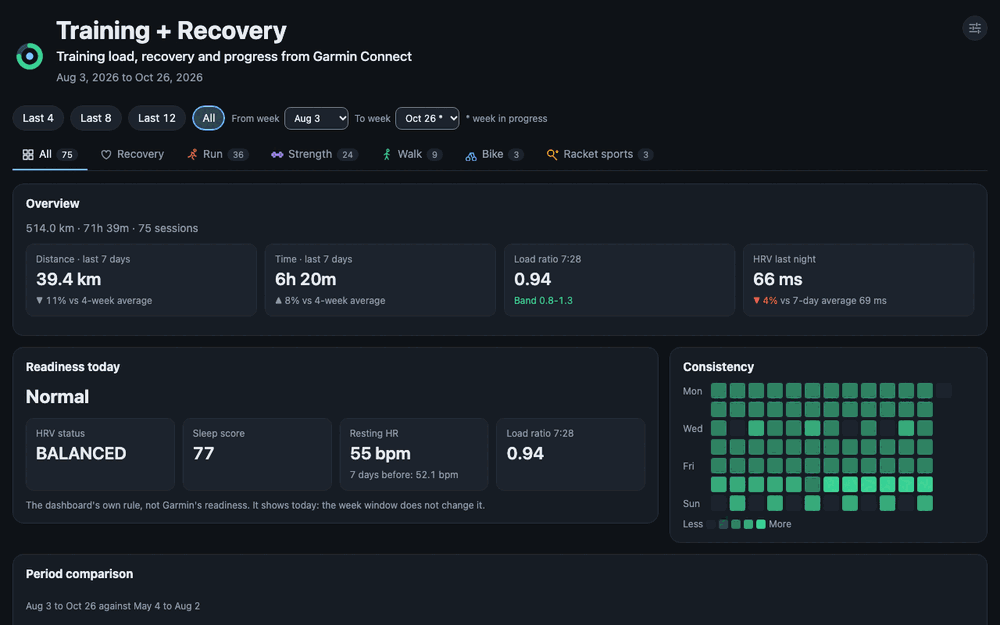

<h1 align="center">
  
  garmin-personal-mcp
</h1>

<p align="center"><b>Your Garmin training in Claude, Codex or any MCP client, through the official Personal API. Read-only, nothing to install.</b></p>

<p align="center">
  🌐 <a href="https://garmin-personal-mcp.indaco.dev/"><b>Website</b></a> &nbsp;&middot;&nbsp; 👉
  <a href="https://garmin-personal-mcp.indaco.dev/demo/"><b>Try the live demo</b></a>
</p>

<p align="center">
  <a href="https://www.npmjs.com/package/@indaco/garmin-personal-mcp"></a>
  <a href="https://codecov.io/gh/indaco/garmin-personal-mcp"></a>
  <a href="https://nodejs.org"></a>
  <a href="tsconfig.json"></a>
  <a href="https://modelcontextprotocol.io"></a>
  <a href="https://developer.garmin.com/gc-developer-program/personal/"></a>
  <a href="LICENSE"></a>
  <a href="https://www.jetify.com/devbox/docs/contributor-quickstart/"></a>
</p>

<p align="center">
  <b><a href="#quick-start">Quick start</a></b> &middot;
  <b><a href="#what-you-can-ask">What you can ask</a></b> &middot;
  <b><a href="#tools">Tools</a></b> &middot;
  <b><a href="#dashboard">Dashboard</a></b> &middot;
  <b><a href="guide/how-it-works.md">How it works</a></b> &middot;
  <b><a href="guide/troubleshooting.md">Troubleshooting</a></b>
</p>

<p align="center">
  An MCP server that lets your assistant read your Garmin data: activities, laps, strength sets,
  sleep, HRV and more. Ask questions in the chat, or let the server build a training dashboard.
</p>

<p align="center">
  
</p>
<p align="center">
  <sub><i>One thing you can build: the training dashboard, with demo data.</i></sub>
</p>

## What you can ask

Ask your assistant anything about your Garmin data, in your own words and in any language. The
assistant chooses the tools and can combine their data. Some examples:

- Activities: "List my last 5 activities, with pace and heart rate."
- Activities: "How much time did I spend in each HR zone on my runs this month?"
- Activities: "How did my sessions named Tempo 5k and Long run change over the last 2 months?"
- Laps: "Show the laps of my last run."
- Strength: "Compare my sets of this week with the week before."
- Strength: "Which muscles did I train most this week?"
- Workouts: "Did I do the reps and rests my workout planned?"
- Recovery: "How did I sleep this week, and how was my HRV?"
- Recovery: "Show my steps, stress and Body Battery for the last 7 days."
- Recovery: "Did my Body Battery recover overnight this week, and which days drained it most?"
- Body: "How has my weight changed over the last 3 months?"
- All together: "My run on Saturday felt hard. Compare it with my sleep and HRV of the nights
  before."

## Features

- **Official and read-only**: uses the Garmin Connect Personal API, writes nothing back, and runs
  with `npx`.
- **All of your data**: laps and strength sets from the original .FIT files, with the muscles of
  each set; HRV, sleep, heart rate, stress and Body Battery; [`garminGet`](#tools) for the other
  endpoints.
- **All stdio clients**: Claude Desktop, Claude Code, Codex and the other MCP clients that use
  stdio. Tested with Claude Desktop and Claude Code.
- **A dashboard in less than a minute**: your training load next to recovery, for you or for your
  coach, with your own widgets and languages. See [Dashboard](#dashboard).
- **Coach prompts**: a review of one run against its planned workout, and a readiness check before a
  race. See [Coach prompts](#coach-prompts).

## Quick start

You need Node.js 22 or later (`node --version` shows the version) and a Garmin Connect account
with access to the [Personal API](https://developer.garmin.com/gc-developer-program/personal/).

### 1. Create a personal API key

1. Open Garmin Connect web at <https://connect.garmin.com/app/settings/personalApiToken>.
2. Select _Create Key_, accept the terms, select the expiry (1 year at most) and select _Create_.
3. Garmin shows the key **only one time**. Save it in a file that only you can read:

```bash
mkdir -p ~/.config/garmin-mcp
nano ~/.config/garmin-mcp/api-key      # paste the key and save
chmod 600 ~/.config/garmin-mcp/api-key
```

You can also give the key in the environment variable `GARMIN_PERSONAL_API_KEY`.

### 2. Connect your client

**Claude Desktop**: select Settings → Developer → _Edit Config_. Add a top-level `mcpServers` key
next to the keys that the file has, not in `preferences`:

```json
{
  "mcpServers": {
    "garmin-personal": {
      "command": "npx",
      "args": ["-y", "@indaco/garmin-personal-mcp@latest"]
    }
  }
}
```

Then quit Claude Desktop **fully**, including the tray icon, and start it again.

**Claude Code**: this command adds the server to all your projects:

```bash
claude mcp add garmin-personal --scope user -- npx -y @indaco/garmin-personal-mcp@latest
claude mcp list          # garmin-personal: ... ✔ Connected
```

Use `--scope project` to write a `.mcp.json` file that you can share in the current repository.

**Codex**: this command adds the server:

```bash
codex mcp add garmin-personal -- npx -y @indaco/garmin-personal-mcp@latest
```

You can also add it to `~/.codex/config.toml`. The first `npx` download can take longer than the
default start time, so set a longer one:

```toml
[mcp_servers.garmin-personal]
command = "npx"
args = ["-y", "@indaco/garmin-personal-mcp@latest"]
startup_timeout_sec = 60
```

Codex does not send your shell environment to the server. Use the key file, or add
`env = { GARMIN_PERSONAL_API_KEY = "..." }` to the table.

**Other clients** (Gemini CLI, VS Code, Cursor and others): in the MCP configuration of the client,
set the command `npx` and the arguments `-y @indaco/garmin-personal-mcp@latest`. Some clients do not
show MCP prompts. In these clients, ask for the dashboard in your own words. The tools are the same.

### 3. Ask your assistant

Ask "list my last 5 activities". The first time that a garmin-personal tool asks for permission, answer
**Allow always** in Claude Desktop. In Claude Code, use `/permissions` and add `mcp__garmin-personal`.

## Tools

| Tool                       | What it gives                                                                  |
| -------------------------- | ------------------------------------------------------------------------------ |
| `listActivities`           | each activity with pace, HR, load and effect, by date, type or name            |
| `getActivity`              | the details of one activity                                                    |
| `getActivityLaps`          | the laps of an activity, from its .FIT file                                    |
| `getActivitySets`          | the strength sets of an activity, with the muscles, from its .FIT file         |
| `getActivityWorkouts`      | the planned workout of an activity: steps, targets and notes                   |
| `downloadActivityFit`      | saves the .FIT file of an activity in the data folder                          |
| `getHrvRange`              | HRV during the night                                                           |
| `getDailyHeartRate`        | the heart rate of a day, with the resting HR                                   |
| `getSleep`                 | the sleep of a night, or of up to 14 nights                                    |
| `getWeight`                | weight and body composition for a range of dates                               |
| `getBodyBattery`           | how Body Battery charged and drained, for up to 14 days                        |
| `getHeartRateZones`        | your HR zones                                                                  |
| `getFitnessAge`            | fitness age against actual age                                                 |
| `getDailySummary`          | steps, stress and Body Battery, for a day or a range                           |
| `getDashboardData`         | all the dashboard data in one call, with the server's totals and a local cache |
| `writeDashboard`           | writes the dashboard page                                                      |
| `editDashboard`            | changes the layout, the custom widgets and the languages of the page           |
| `scheduleDashboardRefresh` | updates a dashboard page automatically, at the times you say in your own words |
| `garminGet`                | all other GET endpoints of the Personal API                                    |

[Tools](guide/tools.md) gives the endpoints, the details of each tool and the data that the
Personal API does not have.

## Dashboard

The server makes a training dashboard with these prompts. In Claude Desktop, the prompts are in
the **+** menu of the message box, under _garmin-personal_. In Claude Code, they are slash commands.

| Prompt                                                  | What it does                                                                              | Claude Code example                                 |
| ------------------------------------------------------- | ----------------------------------------------------------------------------------------- | --------------------------------------------------- |
| [training-dashboard](#training-dashboard)               | makes the page                                                                            | `/garmin-personal:training-dashboard 8`             |
| [training-dashboard-update](#training-dashboard-update) | adds the new data, your layout stays                                                      | `/garmin-personal:training-dashboard-update`        |
| [dashboard-setup](#dashboard-setup)                     | makes a page for you or for your coach, with only the sports and the data that you select | `/garmin-personal:dashboard-setup`                  |
| [dashboard-widget](#dashboard-widget)                   | makes a new widget from your idea                                                         | `/garmin-personal:dashboard-widget my longest ride` |
| [dashboard-language](#dashboard-language)               | adds a language to the page                                                               | `/garmin-personal:dashboard-language German`        |

The prompts remove all spaces around an argument, also the no-break space from a phone keyboard.

### training-dashboard

The server writes the dashboard page from its template, and the assistant writes the coach notes.
The page is one HTML file, `garmin-dashboard.html` in the data folder. It works offline.

| Argument | Values                            | Default  |
| -------- | --------------------------------- | -------- |
| `weeks`  | 1 to 52 (a larger value gives 52) | 12       |
| `layout` | `preset`, `blank` or `freeform`   | `preset` |

- `preset` gives the built-in widgets on each board.
- `blank` gives empty boards: you add the widgets that you want.
- `freeform` lets the assistant design the whole page. This takes much longer, and each page looks
  different.

In Claude Code, the arguments are in order and separated by spaces: first `weeks`, then `layout`.
You can also give only the layout: `/garmin-personal:training-dashboard freeform`.

The assistant gives you the path of the page and the command to open it. The page has a board for
all your training, a Recovery board and a board for each sport. A missing value shows as "n/a".

[The dashboard guide](guide/dashboard.md) tells about the title and the headline, the boards, the
themes and languages, the units and the activity-name filter, and how to change the layout.
[The widget catalogue](guide/widgets.md) lists every widget.

### training-dashboard-update

This prompt replaces the data and the coach notes of the page. Your layout, your custom widgets and
your languages stay. Reload the page to see the new data.

| Argument | Values                                                                  | Default                 |
| -------- | ----------------------------------------------------------------------- | ----------------------- |
| `weeks`  | the weeks to cover                                                      | the weeks of the page   |
| `path`   | the dashboard file, for example `garmin-dashboard-coach.html` (`.html`) | `garmin-dashboard.html` |

In Claude Code: `/garmin-personal:training-dashboard-update coach.html` updates `coach.html`. A
value that ends in `.html` is the file, also in the first place.

To update the page automatically, tell your assistant when, in your own words, for example "update
my dashboard every Monday at 7". See
[Update the dashboard on a schedule](guide/dashboard.md#update-the-dashboard-on-a-schedule).

### dashboard-setup

The assistant asks you some questions, then writes a page with your answers. First, it asks who the
page is for:

- **Personal**: a page for you, with all your data.
- **Shared**: a page for your coach or personal trainer. You select each type of data to include,
  for example HR zones yes, fitness age and sleep no.

Then the assistant asks for the file (any name or path), the title, the headline, the sports, the
languages and the themes. The server writes only the data that you select into the file. Other data
is not in the file, so you can send the file safely. A personal page and a shared page can be two
files side by side. Each page keeps its settings on each update. The argument `weeks` is optional
(default 12).

[Page settings](guide/dashboard.md#page-settings) tells more.

### dashboard-widget

This prompt makes a new widget from your idea, for example "my longest ride of each month". The
assistant writes a small widget, and `editDashboard` stores it in the page and in your widget
library (`widgets.json` in the data folder). The widget stays after each update, and each new page
gets it too. The argument `idea` is required. The argument `path` is optional: it is the file of the
page, for example `coach.html`. In Claude Code:
`/garmin-personal:dashboard-widget my longest ride each month coach.html`. Reload the page to see
the widget.
[Custom widgets](guide/custom-widgets.md) tells more.

### dashboard-language

This prompt adds a language to the dashboard. The assistant translates the texts of the page, and
`editDashboard` stores them in the page. The argument `language` is optional: the default is the
language of the conversation. The argument `path` is optional: it is the file of the page, for
example `coach.html`. In Claude Code: `/garmin-personal:dashboard-language German coach.html`. A
text without a translation shows in English. To remove an added language, ask your assistant to
remove it: `editDashboard` with `removeLanguages`.
[Languages](guide/languages.md) tells more.

### Presets or freeform

In many setup guides for Claude and Garmin, Claude reads the data and writes the whole dashboard
page. With a preset, the server writes the page from a tested template, and Claude writes only the
coach notes. My measurements for a first build, with Claude Code and Opus
(other clients and models give other times and costs):

| First build            | Time         | Cost         |
| ---------------------- | ------------ | ------------ |
| Preset                 | 34 s         | $0.16        |
| Claude writes the page | 24 to 35 min | $6.6 to $9.2 |

For a design of your own, use `layout` = `freeform`: Claude writes the page, as in those guides.

[Presets or freeform](guide/presets.md) gives the measurements and the limits of the presets.

## Coach prompts

These prompts answer in the chat. They do not change a dashboard.

| Prompt                            | What it does                                                | Claude Code example                                       |
| --------------------------------- | ----------------------------------------------------------- | --------------------------------------------------------- |
| [run-review](#run-review)         | reviews one run as a coach                                  | `/garmin-personal:run-review`                             |
| [race-readiness](#race-readiness) | tells if you are ready for a race, with a plan for its pace | `/garmin-personal:race-readiness 2026-11-15 half 1:45:00` |

A missing value shows as "n/a": the assistant does not estimate it.

### run-review

The assistant compares the steps of the planned workout with the laps of the run: the target, what
the lap did, and hit or miss. For intervals, it gives the fade from the first rep to the last. For a
steady run, it gives the HR drift: the drop in distance per heartbeat from the first half to the
second half. It ends with the sleep and HRV of the night after the run, and a short coach note.

| Argument   | Values                                                     | Default      |
| ---------- | ---------------------------------------------------------- | ------------ |
| `activity` | an activity id, or words of the activity name (`Long Run`) | the last run |

### race-readiness

The assistant reads the server's summary of 12 weeks (a `writeDashboard` preview, which writes
nothing) and the laps of your long runs. It gives the days to the race, the weekly run distance and
load, the long runs with their pace split and HR drift, and whether your load drops in the last 2
weeks (the taper). It predicts your race time from your best efforts of 5 km or more (Riegel, an
estimate: the fastest prediction counts), compares it with your goal, and checks the HRV and sleep of
the last 7 nights. It ends with a target pace for each quarter of the race.

| Argument   | Values                                         | Default                  |
| ---------- | ---------------------------------------------- | ------------------------ |
| `date`     | the race date, `yyyy-MM-dd`                    | none: the assistant asks |
| `distance` | `5k`, `10k`, `half`, `marathon`, or a distance | none: the assistant asks |
| `goal`     | your goal time, for example `1:45:00`          | no goal: prediction only |

In Claude Code, give the values in any order: a value in the form `yyyy-MM-dd` is the date, a value
in the form `1:45:00` is the goal, and the other words are the distance. For example
`/garmin-personal:race-readiness half marathon 2026-11-15`.

## Configuration

All the settings are environment variables, and all of them are optional.

| Variable                  | Default                                  | Meaning                                                  |
| ------------------------- | ---------------------------------------- | -------------------------------------------------------- |
| `GARMIN_PERSONAL_API_KEY` | not set                                  | the personal API key. It has priority over the key file. |
| `GARMIN_API_KEY_FILE`     | `~/.config/garmin-mcp/api-key`           | the file with the API key                                |
| `GARMIN_DATA_DIR`         | `~/workspace/garmin-data`                | the data folder                                          |
| `GARMIN_BASE_URL`         | `https://personal.connectapi.garmin.com` | the Personal API host                                    |

To set a variable in Claude Desktop, add an `env` object next to `args`:

```json
"env": { "GARMIN_DATA_DIR": "/absolute/path/to/garmin-data" }
```

In Claude Code, add `--env GARMIN_DATA_DIR=/path/to/garmin-data` to `claude mcp add`.

[The data folder](guide/tools.md#the-data-folder) lists the files that the server keeps and its
log.

## Security

The server is read-only. It sends the API key only to the Garmin token endpoint, and it never logs
or returns the key or the access token. It refuses a key that has spaces or line breaks in it, and
it removes the key and the token from network error messages. If you saw your API key in a chat,
revoke the key on the [API key page](https://connect.garmin.com/app/settings/personalApiToken) and
create a new one. Your .FIT files can have your GPS track, so keep the data folder private.

[SECURITY.md](SECURITY.md) tells how the server protects your data and how to report a
vulnerability. Do not open a public issue for a vulnerability.

The Personal API is for personal use that is not commercial, under the terms of Garmin. Garmin
does not endorse this project, and the project has no affiliation with Garmin.

## Problems and solutions

| Problem                            | Solution                                                                                                                             |
| ---------------------------------- | ------------------------------------------------------------------------------------------------------------------------------------ |
| The server does not start          | Make sure that Node.js is version 22 or later: `node --version`.                                                                     |
| Claude Desktop does not find `npx` | GUI apps do not read your shell profile. Use the absolute path of `npx` (`which npx`) as the `command`.                              |
| Changes have no effect             | The client keeps the old server process. Restart the client: a new Claude Code session, or quit and start Claude Desktop again.      |
| Which version runs                 | `npx -y @indaco/garmin-personal-mcp@latest --version` (or `-v`) prints the version and stops. `--help` (or `-h`) lists the commands. |

[Problems and solutions](guide/troubleshooting.md) has more problems, the log files, and commands
that test the key and the server.

## Contributing

Read [CONTRIBUTING.md](CONTRIBUTING.md). It tells how to run the server from source, and it has
the commands, the test rules and the code map.

To build the website with its demo dashboard (a year of sample data), run `pnpm build:all`. The
site is in `dist-site/`, and the demo in `dist-site/demo/index.html`.

## Credits

The idea comes from [apratico/garmin-mcp](https://github.com/apratico/garmin-mcp) by Alessandro
Praticò: a Java MCP server for the Garmin Personal API, where Claude writes the dashboard. I
tested it in a fork, [indaco/garmin-mcp](https://github.com/indaco/garmin-mcp), and then made this
server as a different solution. It runs with `npx`, without Java, and it writes the dashboard page
from a tested template.

This server uses the same key file as indaco/garmin-mcp and can share its data folder.

## How this was built

AI agents in Claude Code wrote the code, tests and docs of this project. I chose the design,
reviewed each change and tested the server with my own Garmin data. The rules that the agents
follow are in [AGENTS.md](AGENTS.md).

## License

This project uses the [MIT License](LICENSE). `dist/index.js` and the dashboard page include
other libraries with their own licenses: [THIRD-PARTY-NOTICES.md](THIRD-PARTY-NOTICES.md) lists them.
