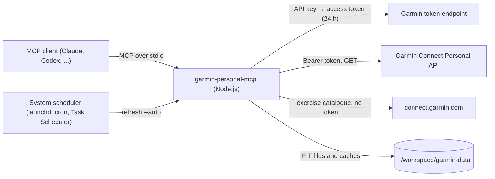

# How it works

- **Transport**: stdio. The client starts the server as a child process and sends JSON-RPC
  messages on stdin and stdout. The process stops when the client stops. Only MCP messages go to
  stdout, so the log goes to a file.
- **Authentication**: the server sends the API key to `POST .../personal-api-key/token` and gets
  an access token. The token is valid for 24 hours, and there is no refresh token. The server keeps
  the token in memory. It gets a new token before the token expires, and after a `401`. Garmin
  can send the token as JSON or as plain text. The server accepts the two formats. Calls that
  start at the same time share one token request.
- **Content type**: JSON calls send `Accept: application/json`. After a `406`, the server sends
  the call again one time with `*/*`.
- **Laps and sets**: the Personal API has no endpoint for laps or exercise sets. For this reason,
  `getActivityLaps` and `getActivitySets` download the original .FIT file one time and keep it in
  the `fit` folder. They read its lap and set messages with the official
  [Garmin FIT SDK](https://github.com/garmin/fit-javascript-sdk). The .FIT file does not include
  changes that you make to the exercises later in Garmin Connect.
- **Muscles**: the .FIT file has no muscle data. `getActivitySets` reads the primary and secondary
  muscles of each exercise from the public exercise catalogue of Garmin. The Garmin Connect web
  app uses the same file. The server downloads it without your token and keeps a copy in
  `exercises.json`. It downloads a new copy after 30 days. If the download fails, the server uses
  the old copy and tries again after 10 minutes. Without a copy, the sets have no muscles.
- **Automatic update**: `scheduleDashboardRefresh` adds one job to the scheduler of the computer
  and writes the cron expression and the pages to `auto-refresh.json`. At each time, the scheduler
  starts the server as a command, `refresh --auto`, without a client. The command updates the data
  of each page and stops. It reads the API key from the key file. The job never holds the key.
- **Dashboard cache**: each `getDashboardData` call keeps its data in `dashboard-cache.json`. The
  next call asks Garmin only for the days after the last call. It also asks again for the last two
  days, because Garmin can still add data to them. The sets and laps come from the .FIT files in
  the `fit` folder, so they need no new download.
